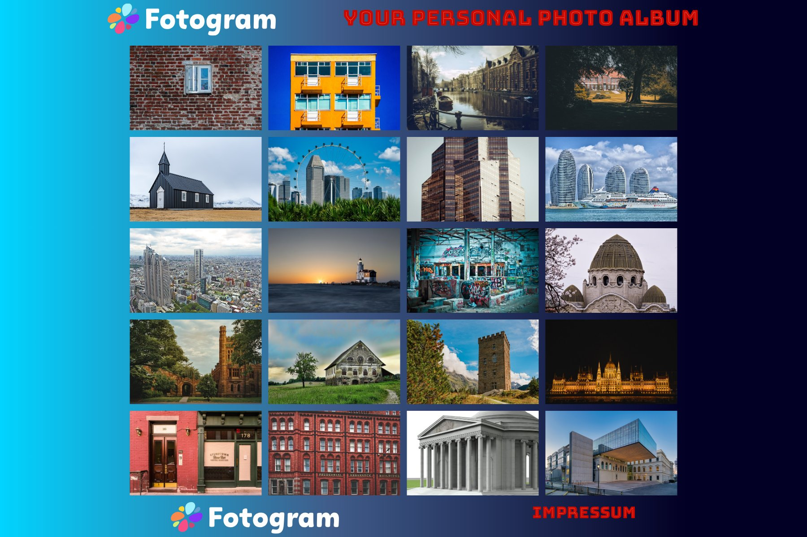
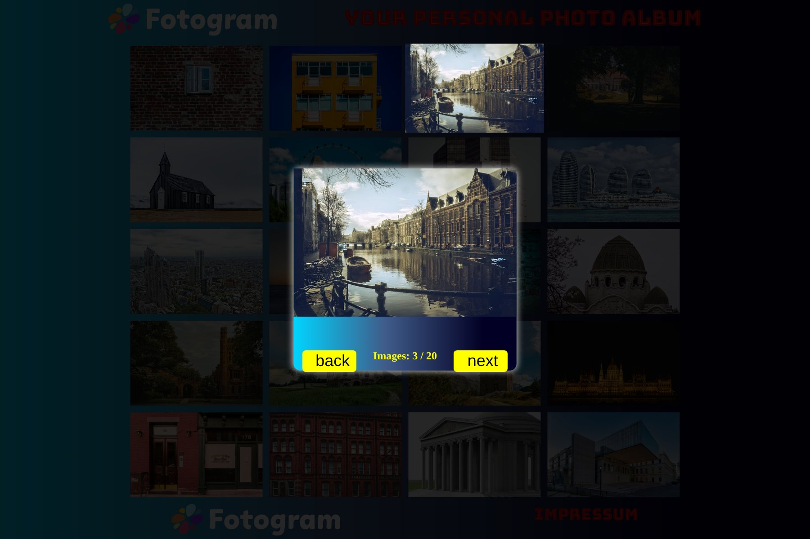

# 📷 Fotogram


> **A photo gallery built with plain HTML, CSS and JavaScript: 20 pictures in a responsive grid, with a detail view and back/next navigation.**



## 🎯 About This Project

Fotogram was one of my first projects during the fullstack web development training at **Developer Akademie**. The goal was to render content from a JavaScript array and to build an image overlay without any library.

## ✨ Features

- 🖼️ **Image grid** – all pictures are rendered from an array with template functions
- 🔍 **Detail view** – click a picture to open it in an overlay
- ⏪ **Back / next navigation** – step through all pictures, wrapping around at both ends
- 🔢 **Position counter** – shows the current picture, e.g. "3 / 20"
- 📱 **Responsive layout**

## 📸 Screenshots

### Detail View


## 🛠️ Tech Stack

- **HTML5**
- **CSS3** – grid layout, custom web font
- **JavaScript (Vanilla)** – DOM rendering with template strings, no dependencies

## ▶️ Run Locally

```bash
git clone https://github.com/Martin-Frei/fotogram.git
cd fotogram
```

Open `index.html` in any modern browser. No build step and no server required.

## 📂 Project Structure

```
fotogram/
├── index.html          # Gallery page
├── script.js           # Rendering, overlay and navigation logic
├── style.css
├── impressum.html      # Legal notice
├── datenschutz.html    # Privacy policy
├── font/               # Bungee Tint web font
├── img/                # Logo, favicon and the 20 gallery pictures
└── screenshots/
```

## 🎓 What I Learned

- Rendering HTML from JavaScript arrays with template functions
- Showing and hiding an overlay with CSS classes
- Index handling for previous / next navigation
- Structuring a small project into HTML, CSS and JavaScript

## 👨‍💻 Author

**Martin Freimuth**
- GitHub: [@Martin-Frei](https://github.com/Martin-Frei)
- LinkedIn: [martin-freimuth](https://www.linkedin.com/in/martin-freimuth-089249359/)
